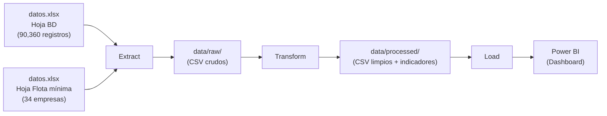
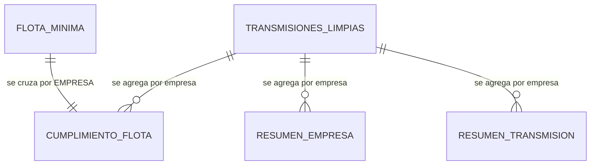

# Evaluación Operativa del Transporte Público Colectivo (TPC) en Medellín

> Pipeline ETL que transforma registros crudos de GPS de autobuses en Medellín, los limpia y deduplica, y genera indicadores agregados listos para consumo en Power BI para auditar el cumplimiento normativo.

**Curso:** ETL — Maestría en Inteligencia Artificial y Ciencia de Datos, Universidad Autónoma de Occidente  
**Periodo:** 2026-2  
**Docente:** Fernando Barraza Alvarado  

## Integrantes

| Nombre | usuario git hub |
|---|
| Santiago Fajardo |
| Marco A. Rojas | marcook888 |

## Tabla de contenido

1. [Descripción del problema](#1-descripción-del-problema)
2. [Fuentes de datos](#2-fuentes-de-datos)
3. [Arquitectura del pipeline](#3-arquitectura-del-pipeline)
4. [Estructura del repositorio](#4-estructura-del-repositorio)
5. [Requisitos](#5-requisitos)
6. [Instalación y configuración](#6-instalación-y-configuración)
7. [Ejecución](#7-ejecución)
8. [Detalle de las etapas ETL](#8-detalle-de-las-etapas-etl)
9. [Modelo y diccionario de datos](#9-modelo-y-diccionario-de-datos)
10. [Calidad de datos y validaciones](#10-calidad-de-datos-y-validaciones)
11. [Resultados](#11-resultados)
12. [Limitaciones y trabajo futuro](#12-limitaciones-y-trabajo-futuro)
13. [Referencias](#13-referencias)

## 1. Descripción del problema

La Secretaría de Movilidad de Medellín exige a las 34 empresas operadoras del Transporte Público Colectivo (TPC) mantener una flota mínima de vehículos en operación y cumplir con las rutas asignadas. Sin embargo, la auditoría de cumplimiento se realiza de forma manual sobre archivos Excel de gran volumen (~90,000 registros por día), lo que introduce latencias de horas o días en la detección de incumplimientos y limita la capacidad de respuesta regulatoria. Además, los datos crudos presentan problemas severos de calidad: el 52.59% de los registros corresponden a vehículos que transmiten GPS pero no prestan servicio en ninguna ruta, el 15.21% tiene firma digital vencida, y existen valores atípicos físicamente imposibles (ej. 5,059 pasajeros en un solo recorrido).

Los datos resultantes del pipeline serían utilizados por el equipo de fiscalización de la Secretaría de Movilidad para auditar el cumplimiento normativo de cada empresa operadora, identificar empresas con baja cobertura de flota, detectar vehículos con comportamiento atípico de transmisión y priorizar acciones regulatorias. Adicionalmente, las propias empresas operadoras podrían consultar sus indicadores de desempeño para mejorar su operación.

**Objetivo:** Construir un pipeline ETL que transforme los registros crudos de transmisión GPS del TPC en un conjunto de datos limpio, deduplicado y enriquecido con indicadores de cumplimiento normativo, listo para alimentar un dashboard que permita a la Secretaría de Movilidad evaluar en qué medida cada empresa cumple con su flota mínima requerida y las rutas asignadas.

## 2. Fuentes de datos

| Fuente | Tipo | Origen | Tamaño aprox. | Frecuencia de actualización | Licencia |
|---|---|---|---|---|---|
| Hoja "BD" (Transmisiones) | XLSX | Archivo `datos.xlsx`, suministrado por la Secretaría de Movilidad de Medellín | 90,360 filas × 26 columnas | Diaria (consolidado del día 24/04/2026) | Uso exclusivamente académico — datos de entidad pública colombiana (Ley 1712/2014), suministrados para fines del curso |
| Hoja "Flota mínima" (Parámetros) | XLSX | Archivo `datos.xlsx`, misma fuente | 34 filas × 2 columnas | Estática (parámetro normativo vigente) | Misma licencia académica |

## 3. Arquitectura del pipeline



El pipeline extrae las dos hojas del archivo Excel y las almacena como CSV crudos en `data/raw/`. Luego aplica las transformaciones de limpieza, deduplicación y enriquecimiento definidas en la Entrega 2 (clasificación de servicio, detección de outliers, marcado de firma vencida, estandarización de transmisión). Finalmente, genera las tablas agregadas con los indicadores de cumplimiento de flota mínima por empresa y las exporta como archivos CSV en `data/processed/`, listos para ser consumidos por Power BI. Se eligió CSV como formato de salida por su compatibilidad directa con Power BI sin necesidad de configurar un servidor de base de datos.

**Tecnologías:** Python 3.11+, pandas, openpyxl

## 4. Estructura del repositorio

```
├── data
│   ├── processed      <- Datos limpios y tablas de indicadores, listos para Power BI.
│   └── raw            <- CSV crudos extraídos del Excel original, sin modificar.
│
├── extract
│   └── extract.py     <- Lee las hojas del Excel y las guarda como CSV en data/raw/.
│
├── transform
│   └── transform.py   <- Aplica limpieza, deduplicación, enriquecimiento y cálculo de indicadores.
│
├── load
│   └── load.py        <- Exporta las tablas finales a data/processed/ para consumo en Power BI.
│
├── pipeline.py        <- Orquesta la ejecución completa (extract → transform → load).
│
├── requirements.txt   <- Dependencias del proyecto.
│
├── .gitignore         <- Archivos que git debe ignorar.
│
└── README.md          <- Este archivo.
```

El repositorio se organizó en módulos independientes (`extract/`, `transform/`, `load/`) para reflejar cada etapa del flujo ETL y facilitar la depuración y el mantenimiento por separado. Se eligió **Python con pandas** como motor de procesamiento por su capacidad para limpiar, transformar y agregar los ~90,000 registros diarios de forma reproducible y scriptable. Como destino final se adoptó **Power BI (Business Intelligence)** porque los usuarios de la Secretaría de Movilidad necesitan explorar el cumplimiento normativo mediante dashboards interactivos con filtros dinámicos (por empresa, ruta, método de transmisión), semáforos de alerta y drill-down hasta nivel de vehículo, sin depender de código ni consultas SQL. Los archivos CSV en `data/processed/` actúan como interfaz de carga liviana entre el pipeline y Power BI, eliminando la necesidad de aprovisionar un servidor de base de datos y manteniendo la solución portable y de rápida puesta en marcha.

## 5. Requisitos

- Python 3.11 o superior
- Dependencias listadas en `requirements.txt`
- Power BI Desktop (para visualizar el dashboard con los datos procesados)

## 6. Instalación y configuración

### 6.1 Entorno Python

```bash
# 1. Clonar el repositorio
git clone https://github.com/marcook888/-Evaluaci-n-Operativa-del-Transporte-P-blico-Colectivo-TPC-en-Medell-n---Proyecto-final-.git
cd -Evaluaci-n-Operativa-del-Transporte-P-blico-Colectivo-TPC-en-Medell-n---Proyecto-final-

# 2. Crear y activar el entorno virtual
python -m venv .venv
source .venv/bin/activate        # Windows: .venv\Scripts\activate

# 3. Instalar las dependencias (pandas, numpy, openpyxl)
pip install -r requirements.txt
```

### 6.2 Archivo de datos

El archivo fuente `datos.xlsx` (~14.5 MB) se encuentra incluido directamente en la raíz del repositorio (`./datos.xlsx`). El pipeline lo lee de forma automática al ejecutar `python pipeline.py`.

> **Nota:** No se requieren variables de entorno, credenciales ni conexión a bases de datos externas. El pipeline opera 100 % con archivos locales. Las carpetas `data/raw/` y `data/processed/` ya se encuentran sincronizadas en el repositorio con sus respectivos conjuntos de datos.

## 7. Ejecución

```bash
# Pipeline completo
python pipeline.py
```

```bash
# Por etapas (opcional)
python extract/extract.py
python transform/transform.py
python load/load.py
```

**Salida esperada:** Al finalizar, se generan 4 archivos CSV en `data/processed/`, listos para importar en Power BI. La ejecución completa tarda aproximadamente 15–30 segundos.

## 8. Detalle de las etapas ETL

### 8.1 Extract

- **Qué hace:** Lee las dos hojas del archivo `datos.xlsx` (Hoja "BD" con 90,360 registros y Hoja "Flota mínima" con 34 registros) y las exporta como CSV crudos sin ninguna modificación.
- **Scripts:** `extract/extract.py`
- **Salida:** `data/raw/bd_transmisiones.csv` y `data/raw/flota_minima.csv`

### 8.2 Transform

- **Qué hace:** Aplica las transformaciones de limpieza, enriquecimiento y agregación diseñadas en la Entrega 2 del proyecto, generando variables derivadas y tablas de indicadores.
- **Scripts:** `transform/transform.py`
- **Salida:** `data/processed/transmisiones_limpias.csv`, `data/processed/cumplimiento_flota.csv`, `data/processed/resumen_empresa.csv`, `data/processed/resumen_transmision.csv`

| # | Transformación | Justificación |
|---|---|---|
| 1 | Clasificación de servicio (`EN_SERVICIO`) | El 52.59% de registros no tienen Código de Ruta; se marcan como fuera de servicio para no inflar el cálculo de flota activa. |
| 2 | Estado de recorrido (`ESTADO_SERVICIO`) | Diferencia recorridos completos (S: 41.20%), parciales (N: 6.21%) y sin servicio (N/A: 52.59%) para calcular correctamente la distribución de estados. |
| 3 | Marcado de integridad (`DATO_CONFIABLE`) | El 15.21% de registros tiene firma digital vencida; se marcan para alertar sobre riesgo de validez legal en auditorías. |
| 4 | Detección de outliers (`OUTLIER`) | Valores como 5,059 pasajeros o 279 km de distancia son físicamente imposibles; se marcan con umbrales operativos (pasajeros > 80, distancia > 50 km, tiempo > 300 min). |
| 5 | Estandarización de transmisión (`METODO_TRANSMISION`) | Unifica TIPO CARGA y ARCHIVO EN LÍNEA en categorías claras: "En Línea", "Batch-WS", "Batch-WR" para clasificar empresas. |
| 6 | Deduplicación y agregación por empresa | COUNT DISTINCT de PLACA por EMPRESA (solo EN_SERVICIO = True) para obtener la cantidad real de vehículos únicos operando. |
| 7 | Cruce con Flota Mínima (Join) | Left Join entre vehículos operando y tabla normativa por EMPRESA. Calcula: `% Cumplimiento = (Vehículos Operando / Flota Mínima) × 100`. |

### 8.3 Load

- **Qué hace:** Exporta las tablas procesadas como archivos CSV en `data/processed/`, listos para importar en Power BI. Modo de carga: reemplazo completo (se sobreescriben los archivos en cada ejecución).
- **Scripts:** `load/load.py`
- **Destino:** `data/processed/` (archivos CSV para Power BI)

## 9. Modelo y diccionario de datos



**Tabla:** `transmisiones_limpias.csv` — Registros individuales enriquecidos con variables derivadas.

| Columna | Tipo | Descripción | Ejemplo |
|---|---|---|---|
| `RECORRIDO` | str | Identificador único del recorrido | `8002086550TSF636...` |
| `PLACA` | str | Placa del vehículo | `TSF636` |
| `EMPRESA` | str | Empresa operadora | `COOTRANSI` |
| `CÓDIGO RUTA` | str | Código de la ruta asignada (vacío = fuera de servicio) | `89901` |
| `RECORRIDO FINALIZADO` | str | Estado original del recorrido | `S`, `N`, `N/A` |
| `EN_SERVICIO` | bool | True si el vehículo opera en ruta (Código Ruta no vacío) | `True` |
| `ESTADO_SERVICIO` | str | Clasificación del recorrido | `Completo`, `Parcial`, `Sin servicio` |
| `DATO_CONFIABLE` | bool | True si FIRMADO=S y FIRMA VENCIDA=N | `True` |
| `OUTLIER` | bool | True si pasajeros > 80, distancia > 50 km o tiempo > 300 min | `False` |
| `METODO_TRANSMISION` | str | Modalidad de transmisión estandarizada | `En Línea`, `Batch-WS`, `Batch-WR` |

**Tabla:** `cumplimiento_flota.csv` — Indicador central: cumplimiento de flota mínima por empresa.

| Columna | Tipo | Descripción | Ejemplo |
|---|---|---|---|
| `EMPRESA` | str | Nombre de la empresa operadora | `METROSAN` |
| `FLOTA_MINIMA` | int | Vehículos mínimos requeridos (dato normativo) | `41` |
| `VEHICULOS_TRANSMITIENDO` | int | Placas únicas que transmitieron (con o sin ruta) | `185` |
| `VEHICULOS_OPERANDO` | int | Placas únicas operando en ruta (EN_SERVICIO = True) | `152` |
| `PCT_CUMPLIMIENTO` | float | (VEHICULOS_OPERANDO / FLOTA_MINIMA) × 100 | `370.7` |
| `CUMPLE` | bool | True si PCT_CUMPLIMIENTO >= 100 | `True` |

**Tabla:** `resumen_empresa.csv` — Métricas de distribución de recorridos por empresa.

| Columna | Tipo | Descripción | Ejemplo |
|---|---|---|---|
| `EMPRESA` | str | Nombre de la empresa | `COONATRA` |
| `TOTAL_REGISTROS` | int | Total de transmisiones de la empresa | `6213` |
| `RUTAS_UNICAS` | int | Cantidad de rutas distintas operadas | `15` |
| `PCT_COMPLETO` | float | % de recorridos en estado "S" | `45.3` |
| `PCT_PARCIAL` | float | % de recorridos en estado "N" | `5.1` |
| `PCT_SIN_SERVICIO` | float | % de recorridos en estado "N/A" | `49.6` |
| `REGISTROS_FIRMA_VENCIDA` | int | Cantidad de registros con firma vencida | `320` |
| `REGISTROS_OUTLIER` | int | Cantidad de registros marcados como outlier | `12` |

**Tabla:** `resumen_transmision.csv` — Clasificación de modalidad de transmisión por empresa.

| Columna | Tipo | Descripción | Ejemplo |
|---|---|---|---|
| `EMPRESA` | str | Nombre de la empresa | `COPATRA` |
| `VEHICULOS_EN_LINEA` | int | Placas que transmiten exclusivamente en línea | `10` |
| `VEHICULOS_BATCH` | int | Placas que transmiten exclusivamente en batch | `45` |
| `VEHICULOS_MIXTO` | int | Placas que transmiten en ambas modalidades | `3` |
| `PCT_EN_LINEA` | float | % de la flota que transmite en línea | `17.2` |

## 10. Calidad de datos y validaciones

| Verificación | Antes (datos crudos) | Después (datos procesados) |
|---|---|---|
| Número de registros (BD) | 90,360 | 90,360 (se conservan todos, marcados con banderas) |
| Registros sin Código de Ruta | 47,519 (52.59%) | 0 sin clasificar (todos marcados con `EN_SERVICIO`) |
| Estado de recorrido ambiguo | 3 valores (S, N, N/A) sin contexto | Clasificados como Completo / Parcial / Sin servicio |
| Registros con firma vencida | 13,742 (15.21%) sin identificar | Marcados con `DATO_CONFIABLE = False` |
| Outliers sin detectar | Valores de hasta 5,059 pasajeros | Marcados con `OUTLIER = True` (umbrales operativos) |
| Duplicidad por placa | 90,360 registros (~39 por vehículo) | Deduplicado a 2,311 placas únicas en tabla de cumplimiento |
| Cruce con Flota Mínima | No existía | 34 empresas con % de cumplimiento calculado |
| Modalidad de transmisión | Dos columnas separadas (TIPO CARGA + ARCHIVO EN LÍNEA) | Unificada en `METODO_TRANSMISION` (3 categorías) |

## 11. Resultados

El pipeline genera 4 archivos CSV en `data/processed/` que alimentan el dashboard en Power BI:

- **`transmisiones_limpias.csv`** — 90,360 registros enriquecidos con 5 variables derivadas (EN_SERVICIO, ESTADO_SERVICIO, DATO_CONFIABLE, OUTLIER, METODO_TRANSMISION).
- **`cumplimiento_flota.csv`** — 34 filas (una por empresa) con el % de cumplimiento de flota mínima.
- **`resumen_empresa.csv`** — 34 filas con métricas de distribución de recorridos, firmas vencidas y outliers por empresa.
- **`resumen_transmision.csv`** — 34 filas con la clasificación de modalidad de transmisión (en línea / batch / mixto) por empresa.

```python
# Ejemplo de consulta sobre los datos procesados
import pandas as pd
df = pd.read_csv('data/processed/cumplimiento_flota.csv')
print(df.sort_values('PCT_CUMPLIMIENTO').head(5))  # 5 empresas con menor cumplimiento
```

## 12. Limitaciones y trabajo futuro

- **Datos de un solo día:** El análisis se basa exclusivamente en los registros del 24 de abril de 2026. Un pipeline productivo debería procesar datos diarios acumulados para identificar tendencias de cumplimiento a lo largo del tiempo.
- **Umbrales de outliers fijos:** Los umbrales de detección de valores atípicos (pasajeros > 80, distancia > 50 km) son reglas estáticas de negocio. Un enfoque futuro podría usar métodos estadísticos adaptativos (IQR, z-score por empresa).
- **Sin carga a base de datos:** El destino actual son archivos CSV para Power BI. Una mejora sería cargar directamente a una base de datos (PostgreSQL, BigQuery) para habilitar consultas SQL y actualización incremental.
- **Sin automatización de ejecución:** El pipeline se ejecuta manualmente. Con más tiempo, podría orquestarse con un scheduler (cron, Airflow) para procesamiento automático diario.

## 13. Referencias

- Secretaría de Movilidad de Medellín — Archivo de transmisiones del sistema TPC, suministrado para fines académicos en el semestre 2026-2.
- Ley 1712 de 2014 — Ley de Transparencia y Acceso a la Información Pública de Colombia.
- pandas documentation — [https://pandas.pydata.org/docs/](https://pandas.pydata.org/docs/)
- NumPy documentation — [https://numpy.org/doc/](https://numpy.org/doc/)
- openpyxl documentation — [https://openpyxl.readthedocs.io/](https://openpyxl.readthedocs.io/)
- Power BI documentation — [https://learn.microsoft.com/es-es/power-bi/](https://learn.microsoft.com/es-es/power-bi/)

---

